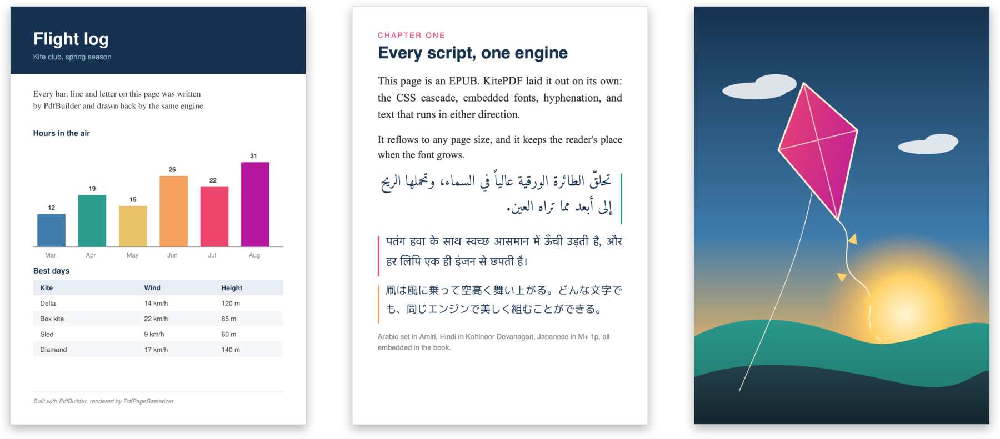

<p align="center">
  
</p>

<p align="center">
  A pure-Kotlin document engine for Kotlin Multiplatform.<br>
  Read, create, edit and render PDF files. Read and render EPUB 2 and 3 books, audio and video included.<br>
  Both formats run their own JavaScript, and all of it works from <code>commonMain</code>.
</p>

<p align="center">
  It also reads and renders CBZ comics, SVG images, and XPS or OpenXPS documents.
</p>

<p align="center">
  <sub>AI tools helped a great deal in building this project, which would not have been possible
  without them. Its author directed and reviewed all of the work.</sub>
</p>

<p align="center">
  <a href="https://central.sonatype.com/artifact/io.github.yuroyami/kitepdf"></a>
  <a href="https://github.com/yuroyami/KitePDF/actions/workflows/ci.yml"></a>
  <a href="https://yuroyami.github.io/KitePDF/"></a>
  <a href="https://kotlinlang.org"></a>
  <a href="LICENSE"></a>
</p>

<p align="center">
  <b><a href="https://yuroyami.github.io/KitePDF/">Documentation</a></b> · a guide for each task, plus the generated API reference.
</p>

<p align="center">
  
  <br>
  <sub>A PDF, an EPUB and an SVG, each rendered by KitePDF.</sub>
</p>

## Why KitePDF

KitePDF is a single engine written in Kotlin from the parser up. It doesn't rely on any platform PDF library, web view, JNI or native binary, which is why it behaves identically across Android, iOS, the desktop JVM, macOS, Linux, Windows and the web.

That means the logic lives in `commonMain` instead of being handed off to a different engine on each platform through expect/actual, which in many cases leads to inconsistent behavior.

| Format | View in Compose | Render to image | Edit | Create | JavaScript |
| --- | :---: | :---: | :---: | :---: | :---: |
| **PDF** | ✓ | ✓ | ✓ | ✓ | ✓ |
| **EPUB 2 and 3** | ✓ | ✓ | Not yet | Not yet | ✓ |
| **CBZ** | ✓ | ✓ | Not yet | Not yet | n/a |
| **SVG** | ✓ | ✓ | Not yet | Not yet | Not yet |
| **XPS and OpenXPS** | ✓ | ✓ | Not yet | Not yet | n/a |

## Install

```kotlin
kotlin {
    sourceSets {
        commonMain.dependencies {
            // Every format: PDF, EPUB, CBZ, SVG, XPS and OpenXPS
            implementation("io.github.yuroyami:kitepdf:0.13.0")

            // Or one format only
            implementation("io.github.yuroyami:kitepdf-pdf:0.13.0")
            implementation("io.github.yuroyami:kitepdf-epub:0.13.0")
            implementation("io.github.yuroyami:kitepdf-cbz:0.13.0")
            implementation("io.github.yuroyami:kitepdf-svg:0.13.0")
            implementation("io.github.yuroyami:kitepdf-xps:0.13.0")

            // Optional, depending on what you build
            implementation("io.github.yuroyami:kitepdf-compose-viewer:0.13.0")   // KiteDocView for Compose Multiplatform
            implementation("io.github.yuroyami:kitepdf-native-renderer:0.13.0")  // page to image on the platform canvas
            implementation("io.github.yuroyami:kitepdf-skia-renderer:0.13.0")    // page to image on Skia (on Android, add one repository)
            implementation("io.github.yuroyami:kitepdf-javascript:0.13.0")       // runs the JavaScript inside PDFs and EPUBs (pulls in KiteJS)
            implementation("io.github.yuroyami:kitepdf-net:0.13.0")              // loads documents from a URL (add a Ktor engine too)
            implementation("io.github.yuroyami:kitepdf-media:0.13.0")            // plays EPUB audio and video in KiteDocView (pulls in KitePlayer)
        }
    }
}
```

For example, a reader app that shows every format in Compose with JavaScript, media playback and network loading needs these lines:

```kotlin
commonMain.dependencies {
    implementation("io.github.yuroyami:kitepdf:0.13.0")
    implementation("io.github.yuroyami:kitepdf-compose-viewer:0.13.0")
    implementation("io.github.yuroyami:kitepdf-javascript:0.13.0")
    implementation("io.github.yuroyami:kitepdf-media:0.13.0")
    implementation("io.github.yuroyami:kitepdf-net:0.13.0")
}
```

A server or a command-line tool that only turns PDF pages into images, with no Compose UI at all, needs just two:

```kotlin
commonMain.dependencies {
    implementation("io.github.yuroyami:kitepdf-pdf:0.13.0")
    implementation("io.github.yuroyami:kitepdf-native-renderer:0.13.0")   // or kitepdf-skia-renderer
}
```

### What else you need

> [!WARNING]
> Two artifacts need something extra (without it, the build or the download fails).

| If you add | You also need |
| --- | --- |
| `kitepdf-net` | A Ktor client engine (such as `io.ktor:ktor-client-cio:3.6.0`) |
| `kitepdf-skia-renderer` on Android | One more repository (`maven("https://maven.pkg.jetbrains.space/public/p/compose/dev")`) |

> [!TIP]
> On iOS, `kitepdf-media` needs a few linker flags plus two privacy manifest entries ([KitePlayer's install guide](https://github.com/yuroyami/KitePlayer#install) lists them). A missing manifest entry doesn't break the build (Apple only flags it during app review).

## Usage

### Open a document

```kotlin
import io.github.yuroyami.kitepdf.PdfDocument
import io.github.yuroyami.kitepdf.document.KiteDoc

val doc = PdfDocument.open(bytes)      // a PDF; PdfDocument.open(bytes, "secret") if it is locked
val any = KiteDoc.open(bytes)          // any format, detected from the bytes
KiteDoc.formatOf(bytes)                // Pdf, Epub, Cbz, Svg, Xps, or null
```

Besides bytes, `KiteDoc` can also open a file path, a `File`, an `InputStream`, an Android content `Uri`, Apple's `NSData` or `NSURL`, Base64 text or a `data:` URI (plus a remote URL through `kitepdf-net`).

### Show it in Compose

Assuming you added the `kitepdf-compose-viewer` module, you get a composable that can show any document format. Here is its full API surface:

```kotlin
import androidx.compose.foundation.gestures.Orientation
import androidx.compose.foundation.layout.fillMaxSize
import androidx.compose.runtime.Composable
import androidx.compose.ui.Modifier
import androidx.compose.ui.unit.dp
import io.github.yuroyami.kitepdf.compose.*
import io.github.yuroyami.kitepdf.core.KiteDocument

@Composable
fun Viewer(doc: KiteDocument) {
    KiteDocView(
        state = rememberKiteDocViewState(doc),
        modifier = Modifier.fillMaxSize(),
        layout = KiteDocLayout.Paged(Orientation.Horizontal),  // or Continuous(), Spread(), SinglePage(index)
        zoomSpec = KiteZoomSpec(maxZoom = 6f),                 // pinch, double tap, pan, zoom bounds
        renderSpec = KiteRenderSpec.Rasterized(),              // or KiteRenderSpec.Vectorized()
        colors = KiteDocViewColors(),                          // paper, background, highlights, reader theme
        pageSpacing = 8.dp,
        userScrollEnabled = true,                              // false leaves paging to the state
        selectionEnabled = true,                               // long press selects text
        onPageRendered = { page, bitmap -> },                  // a fresh bitmap of a page
        pagePlaceholder = { page -> },                         // shown while a page renders
        chapterPlaceholder = { chapter -> },                   // shown while a chapter lays out
        overlay = { KitePageIndicator(it) },                   // floats above the pages
        pageOverlay = { },                                     // moves with each page (KiteMediaOverlay goes here)
        onTap = { offset -> },
        onLinkTap = { link -> false },                         // return true once you handled the link
        onHighlightTap = { highlight -> false },
        scripts = null,                                        // a PdfScriptRunner runs a PDF's scripts
        epubScripts = null,                                    // an EpubScriptRunner runs a book's scripts
        externalLinks = KiteExternalLinks(),                   // asks before opening web or mail links
        showMarkupErrors = true,                               // flags a chapter with broken markup
    )
}
```

The viewer can:

- [x] Zoom with a pinch, a double tap, Ctrl plus the wheel or the keyboard
- [x] Lay pages out as a continuous strip, a pager, a two-page spread or a single page
- [x] Turn pages with a swipe, the mouse wheel or the keyboard
- [x] Select text (with draggable handles plus a selection menu)
- [x] Follow links inside the document (it asks before opening a web or mail link)
- [x] Highlight search hits along with your own saved highlights
- [x] Recolor pages with a dark or sepia reader theme
- [x] Expose the text and its links to a screen reader

`renderSpec` sets how the viewer draws a page:

| | `Rasterized` (default) | `Vectorized` |
| --- | --- | --- |
| **How it draws** | It draws each page one time into a bitmap. Gestures move that bitmap. | It draws the page content again when the size, the zoom or the theme changes. |
| **Where it draws** | It draws off the UI thread. On the web, it draws on the UI thread because the web has only one thread. | It draws on the UI thread. |
| **First display** | A placeholder shows until the bitmap is ready. | The page shows after the first draw. This draw blocks the UI thread. |
| **Scroll and pan** | Scroll and pan are smooth on all pages. | Scroll and pan are smooth on simple pages. On a complex page, they can be slow. |
| **Zoom quality** | The page is not sharp during a pinch. It becomes sharp again when the zoom stops (`rerasterizeOnZoom`). | On Android, the page stays sharp during a pinch. On iOS, desktop and web, the page is not sharp during a pinch until it draws again. |
| **Memory** | Each page uses one bitmap. `maxBitmapLongSide` sets the maximum size of the bitmap. | There is no page bitmap. Images use a shared cache of 16 MiB (`imageCacheBudgetBytes`). |
| **Thin lines** | Thin lines stay visible when the bitmap becomes smaller (`preserveHairlines`). | A line with zero width is one device pixel wide (`hairlineWidthPx`). |
| **Use it for** | Use it for dense pages, scans, comics, photos or slow devices. | Use it for text pages, forms, deep zoom or low memory. |

### Read and search text

```kotlin
import io.github.yuroyami.kitepdf.text.search

val page = doc.pages[0]

page.extractText()            // the page as plain text
page.structuredText.blocks    // blocks of lines of spans, each with its bounds
page.search("invoice")        // the hits on this page
doc.search("invoice")         // every hit in the document, page by page
```

Each span carries the position of its characters, which is what you need to draw a text
selection. The document also gives you its metadata (`doc.info` and `doc.xmp`), its
bookmarks, page labels (`page.label`), attachments, permissions and form fields.

### Fill forms, edit and redact

`doc.edit()` gives you a `PdfEditor` that collects your changes until you save them, either
with `saveIncremental()` (which appends them to the original file) or with `saveRewritten()`
(which writes a clean new file).

```kotlin
import io.github.yuroyami.kitepdf.core.KiteRectangle

val filled = doc.edit().apply {
    setTextFieldValue(doc.formField("ApplicantName")!!, "Jane Doe")
    setCheckbox(doc.formField("AgreeToTerms")!!, checked = true)
    setChoiceValue(doc.formField("Country")!!, "Norway")
}.saveIncremental()

val redacted = doc.edit().apply {
    redactRegions(doc.pages[0], listOf(KiteRectangle(72.0, 700.0, 320.0, 720.0)))
}.saveRewritten()
```

Redaction removes the content inside each region (text, images, vector paths and the
contents of annotations and form fields) instead of painting a black box over it. Some
content can still survive, as the [limitations](#a-few-limitations-to-know-about) explain.

> [!WARNING]
> Save a redaction with `saveRewritten()`. After a redaction, `saveIncremental()` throws, because the original content would stay in the file.

### Create a PDF

<details>
<summary><b>The full builder DSL</b></summary>
<br>

```kotlin
import io.github.yuroyami.kitepdf.PdfPermissions
import io.github.yuroyami.kitepdf.writer.*

val font = EmbeddedFont.load(fontBytes)                           // TTF or OTF, cut down to the glyphs you use
val photo = PdfImage.jpeg(jpegBytes, width = 640, height = 480)   // or rgba(), rgb(), gray(), jpx()
val title = "Quarterly report"
val titleWidth = StandardFont.HelveticaBold.stringWidth(title, fontSize = 24.0)

val pdf = PdfBuilder()
    .setInfo(
        title = "Report",
        author = "Jane Doe",
        subject = "Sales",
        keywords = "q3, sales",
        creator = "MyApp",
        producer = "MyApp",
    )
    .page(width = 595.0, height = 842.0) {                        // A4 in points (US Letter if left out)
        // Text, the short way
        text(StandardFont.HelveticaBold, 24.0, (595.0 - titleWidth) / 2, 780.0, title)
        text(font, 12.0, 72.0, 750.0, "Set in an embedded font")

        // Text, line by line
        beginText()
        setFont(StandardFont.TimesRoman, 11.0)
        setLeading(14.0)
        setCharSpacing(0.2)
        setWordSpacing(1.0)
        moveText(72.0, 720.0)
        showText("First line")
        nextLine()
        showText("Second line")
        endText()

        // Lines, shapes and colors
        setLineWidth(2.0)
        setStrokeRgb(0.2, 0.4, 0.8)
        setFillCmyk(0.0, 0.1, 0.9, 0.0)
        rectangle(72.0, 560.0, 200.0, 100.0).fillAndStroke()
        setFillGray(0.9)
        moveTo(300.0, 560.0).lineTo(400.0, 660.0).lineTo(500.0, 560.0).closePath().fill()
        setStrokeGray(0.5)
        raw("[6 3] 0 d")                                          // any operator the DSL lacks (here a dash)
        moveTo(72.0, 540.0).lineTo(523.0, 540.0).stroke()

        // An image inside a clip
        save()
        rectangle(72.0, 300.0, 320.0, 240.0).clip().endPath()    // or clipEvenOdd()
        drawImage(photo, x = 72.0, y = 300.0, width = 320.0, height = 240.0)
        restore()

        // A square turned 45 degrees
        save()
        transform(0.7071, 0.7071, -0.7071, 0.7071, 450.0, 300.0)
        setFillRgb(1.0, 0.0, 0.0)
        rectangle(0.0, 0.0, 50.0, 50.0).fill()
        restore()
    }
    .apply {                                                      // a page built outside a block
        addPage(content = newPageContent().text(StandardFont.Courier, 10.0, 72.0, 760.0, "Page two"))
    }
    .encrypt(
        userPassword = "user-pass",
        ownerPassword = "owner-pass",
        permissions = PdfPermissions.allowAll.copy(canModifyContents = false),
        encryptMetadata = true,
        random = secureRandom,                                    // a secure random (Random.Default is not safe for keys)
    )
    .build(compress = true)
```

</details>

> [!TIP]
> Wrap a few drawing calls in `save()` and `restore()` to keep their settings to themselves. Anything you change in between (a color, a line width, a clip or a rotation) goes back to how it was after `restore()`.
>
> Without them, each setting sticks for the rest of the page:
> - A fill color paints every later shape in that color.
> - A rotation turns everything you draw after it.
> - A clip cuts off everything you draw after it (only `restore()` can remove a clip).
>
> Always use them as a pair. A `save()` without a `restore()` means the settings stick for the rest of the page, while a `restore()` without a `save()` before it breaks the PDF rules.

### Render a page to an image (headless rendering)

```kotlin
/*
 * kitepdf-native-renderer
 * Draws with each platform's own canvas.
 */

// JVM (also renderToImage, encodeToJpeg)
AwtPdfRasterizer.encodeToPng(pdfPage, scale = 2.0)

// Android: a Bitmap
AndroidPdfBitmapRenderer.renderToBitmap(pdfPage)

// iOS, macOS, tvOS: a PNG as NSData
ApplePdfRasterizer.renderToPngData(pdfPage)

// Browser: any page, on your <canvas>
page.renderTo(Canvas2dCanvas(context2d))

/*
 * kitepdf-skia-renderer
 * Same result on every target.
 */

// A PNG (or a Skia Image with renderToImage)
PdfPageRasterizer.encodeToPng(pdfPage)
EpubPageRasterizer.encodeToPng(epubPage)

/*
 * kitepdf-compose-viewer
 * Draws any page, CBZ, SVG and XPS included.
 */

// Inside a composable: an ImageBitmap
val rasterizer = rememberKitePageRasterizer()
rasterizer.rasterize(page, 1200, 1600)
```

### Play EPUB 3 audio and video

Audio and video are a niche feature exclusive to EPUB 3, which is why the `kitepdf-media` module is not part of the `kitepdf` umbrella artifact (you have to add it yourself). It plays each `<audio>` or `<video>` element right on its page through [KitePlayer](https://github.com/yuroyami/KitePlayer). Without it, the viewer only shows the poster image of each element.

```kotlin
import androidx.compose.runtime.*
import io.github.yuroyami.kitepdf.compose.*
import io.github.yuroyami.kitepdf.epub.EpubDocument
import io.github.yuroyami.kitepdf.media.KiteMediaOverlay
import io.github.yuroyami.kitepdf.media.KiteReadAloud

@Composable
fun EpubReader(epub: EpubDocument) {
    val state = rememberKiteDocViewState(epub)
    var narrating by remember { mutableStateOf(false) }

    // A player on each audio or video element
    KiteDocView(state, pageOverlay = {
        KiteMediaOverlay()
    })

    // Reads the narration aloud while narrating is true
    KiteReadAloud(
        state = state,
        playing = narrating,
        onFinished = { narrating = false },
    )
}
```

`KiteReadAloud` plays the media overlays of the EPUB (the EPUB 3 name for narration that follows the text). For an EPUB with text but no recorded audio, you can pass your own speech engine as `speak`.

### Run the JavaScript in a PDF or an EPUB

> [!WARNING]
> The scripting API is experimental and will very probably change in a coming release (in particular, how you create a runner and hand it to the viewer).

PDF forms often use JavaScript to add up totals or format what you type, while EPUB chapters can carry quizzes or interactive pages. The core library never runs these scripts by itself, which is why the `kitepdf-javascript` module is not part of the umbrella artifact either (you have to add it yourself). It runs the scripts on [KiteJS](https://github.com/yuroyami/KiteJS), a JavaScript engine for Kotlin Multiplatform, right on KitePDF's own layout (no web view involved).

```kotlin
import androidx.compose.runtime.*
import io.github.yuroyami.kitepdf.PdfDocument
import io.github.yuroyami.kitepdf.compose.*
import io.github.yuroyami.kitepdf.epub.EpubDocument
import io.github.yuroyami.kitepdf.javascript.*

/*
 * In the viewer
 * Taps, typing and timers reach the scripts.
 */

@Composable
fun PdfForm(pdf: PdfDocument) {
    val scripts = remember(pdf) { PdfScriptRunner(pdf) }
    DisposableEffect(scripts) {
        onDispose { scripts.close() }
    }

    KiteDocView(
        state = rememberKiteDocViewState(pdf),
        scripts = scripts,
    )
}

@Composable
fun EpubQuiz(epub: EpubDocument) {
    val scripts = remember(epub) { EpubScriptRunner(epub) }
    DisposableEffect(scripts) {
        onDispose { scripts.close() }
    }

    KiteDocView(
        state = rememberKiteDocViewState(epub),
        epubScripts = scripts,
    )
}

/*
 * Without a screen
 * Fill a form the way a viewer would.
 */

PdfScriptRunner(pdf).use { runner ->
    // The document's own scripts, then its open action
    runner.runDocumentOpen()

    // Runs the scripts of the field
    runner.setFieldValue("price", "1200")

    // "$1,200.00", as the form worked it out
    runner.formattedValue("total")
}
```

## Platforms

The format modules (`kitepdf` with `-pdf`, `-epub`, `-cbz`, `-svg`, `-xps` and `-core`) run on every platform below, plus watchOS, Android Native and WASI. `kitepdf-net` covers the same list except Android Native and WASI. The other modules support fewer targets, which is the most common reason a first build fails to resolve:

| | Compose<br>Viewer | Native<br>Headless<br>Renderer | Skia<br>Headless<br>Renderer | JS<br>Scripts | Media |
| --- | :---: | :---: | :---: | :---: | :---: |
| **Android** | 24 | 29 | 24 | 21 | 26 |
| **JVM** | ✓ | ✓ | ✓ | ✓ | ✓ |
| **iOS** | ✓ | ✓ | ✓ | ✓ | ✓ |
| **macOS** | ✓ | ✓ | ✓ | ✓ | |
| **tvOS** | | ✓ | ✓ | | |
| **Linux** | | | ✓ | ✓ | |
| **Windows** | | | | ✓ | |
| **JS** | ✓ | ✓ | ✓ | ✓ | |
| **Wasm** | ✓ | | ✓ | ✓ | |

## A few limitations to know about

- A redaction can leave some content in the file. The [editing guide](https://yuroyami.github.io/KitePDF/editing/#what-redaction-removes) lists all the cases.
- KitePDF does not make a digital signature. `PdfSigner` prepares the signature field, and your app makes the signature.
- `PdfSignature.validate` does not get revocation data from the network. It uses the data in the file and the data that you give it.
- KitePDF can open a file that has RC4 encryption, but it cannot edit that file.
- On an RGB page, overprint is approximately correct.
- If image data is damaged or in a format that KitePDF cannot decode, the page shows a gray box in its place.
- KitePDF does not hyphenate Czech, Macedonian, Indonesian, Armenian, Latvian or Romanian. The patterns for these languages use the GPL, the LGPL or no license. An Apache-2.0 library cannot include them.

Missing features and known bugs are [open issues](https://github.com/yuroyami/KitePDF/issues).

## Sample app

`sample/` is a Compose Multiplatform app that can open any document and try out the API.
The desktop version runs on its own (`./gradlew :sample:run`), while the Android and iOS
entry points need a host app of your own.

## License

Apache-2.0. KitePDF contains no third-party source code, but it bundles some third-party
data (fonts, glyph lists, CMaps, encoding tables and hyphenation patterns), each under its
own license. [NOTICE](NOTICE) lists every piece with its source.

Part of the Kite family: [KiteCore](https://github.com/yuroyami/KiteCore),
[ImageKodec](https://github.com/yuroyami/ImageKodec),
[KiteJS](https://github.com/yuroyami/KiteJS),
[KitePlayer](https://github.com/yuroyami/KitePlayer),
[KiteQR](https://github.com/yuroyami/KiteQR).
